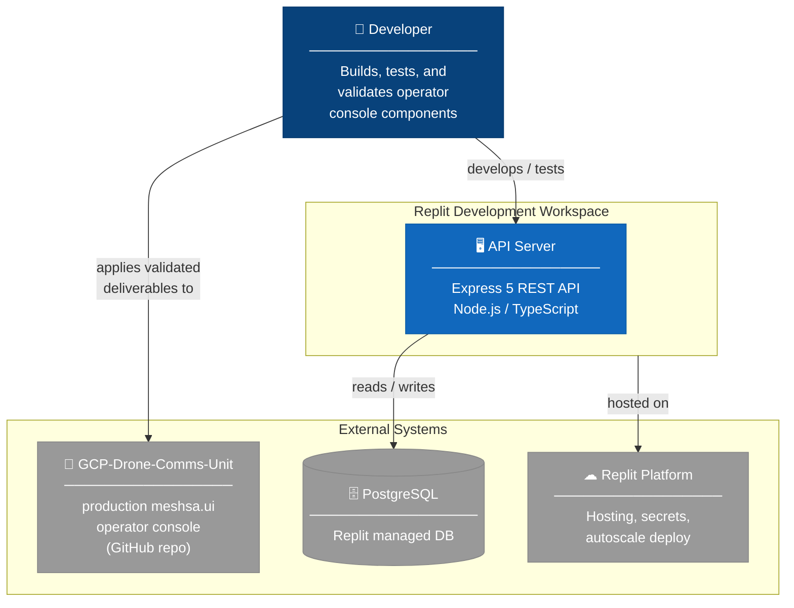
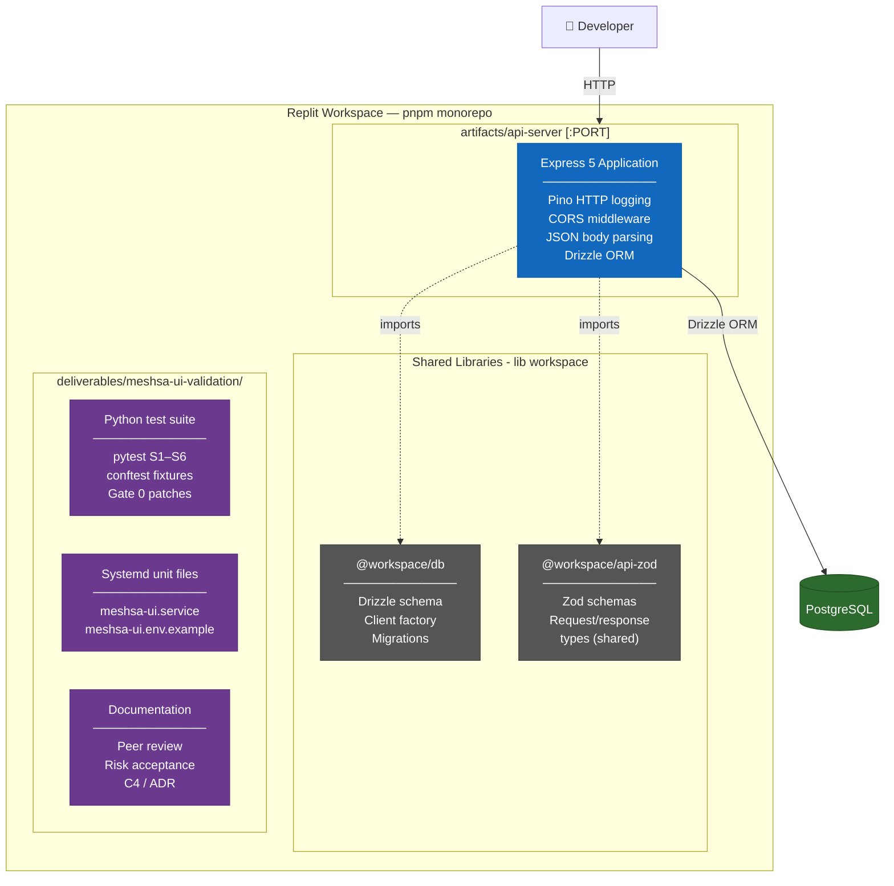
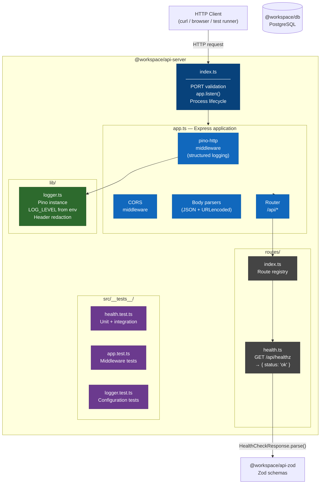
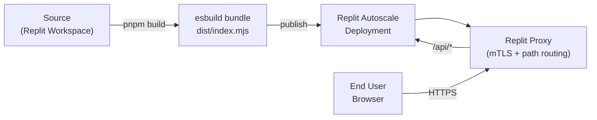

# C4 Architecture — GCP-Drone-Comms-Unit Workspace

Diagrams follow the [C4 model](https://c4model.com/).  All diagrams are rendered
with [Mermaid](https://mermaid.js.org/) (GitHub, VS Code, and most CI platforms
render these natively).

> The React/Vite mockup sandbox and the `@workspace/api-client-react` hooks library were
> archived in plan P3-4 (2026-11-09) and no longer appear below; the trees are kept
> read-only under `../../archive/` (see its README). The drone-comms C4 is
> [`../C4.md`](../C4.md).

---

## Level 1 — System Context

Who uses the system and what other systems does it interact with.

---

## Level 2 — Container

The containers (deployable/runnable units) inside the workspace.

---

## Level 3 — Component (API Server)

The components inside the `api-server` container.

---

## Deployment

---

## Key architectural decisions

See [`docs/adr/`](../adr/) for full Architecture Decision Records.

| Decision | Choice | Rationale |
|---|---|---|
| Package manager | pnpm workspaces | Strict hoisting, catalog pinning, `minimumReleaseAge` security policy |
| Module format | ESM (`"type": "module"`) | Native Node.js ESM; compatible with Vite and Vitest without transforms |
| Bundler | esbuild (api-server) | Sub-second single-file Node.js bundle (Vite left with the archived sandbox) |
| Logging | pino + pino-http | Structured JSON; lowest-overhead Node.js logger; header redaction built-in |
| Schema validation | Zod (shared via @workspace/api-zod) | Single source of truth for request/response shapes; TypeScript inference |
| ORM | Drizzle | Type-safe SQL; minimal runtime; schema-first migrations |
| Testing | Vitest | ESM-native; works without transforms; compatible with pnpm workspaces |
| Container runtime | Node.js 24 Alpine | Smallest footprint; LTS; ESM built-in support |
